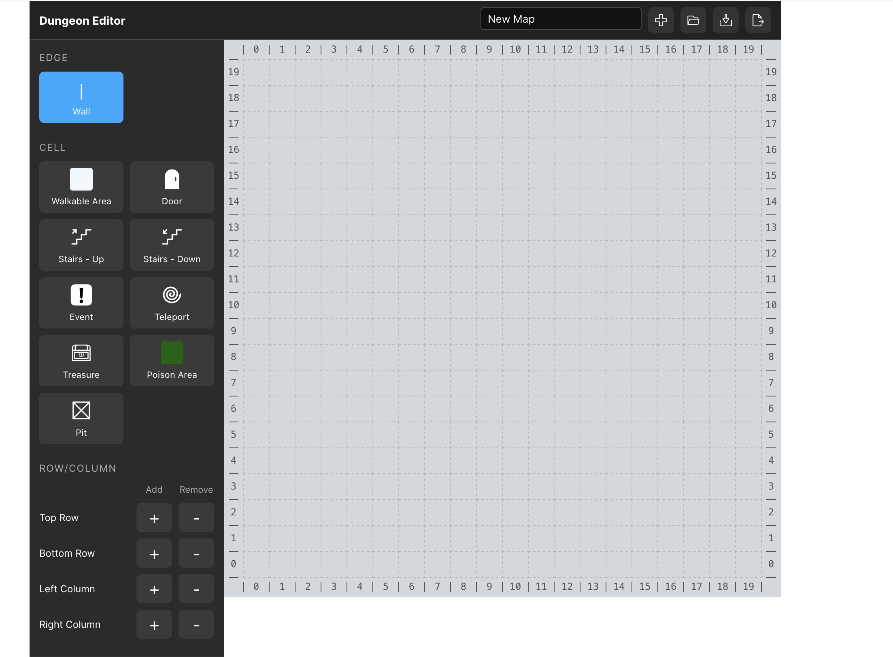

# Dungeon RPG Map Editor

A web-based dungeon map editor built with Vue 3 and TypeScript.

<a href="https://astroneko404.github.io/Dungeon-Map-Maker/" target="_blank">https://astroneko404.github.io/Dungeon-Map-Maker/</a>

### Features
* Interactive Map Editor
* Import and export maps in JSON format
* Export maps as SVG, PNG, or JPEG

### Assets
Some icons are made by Meko <a href="https://thenounproject.com/creator/MekoDa/">(https://thenounproject.com/creator/MekoDa/)</a> (CC BY 3.0)
